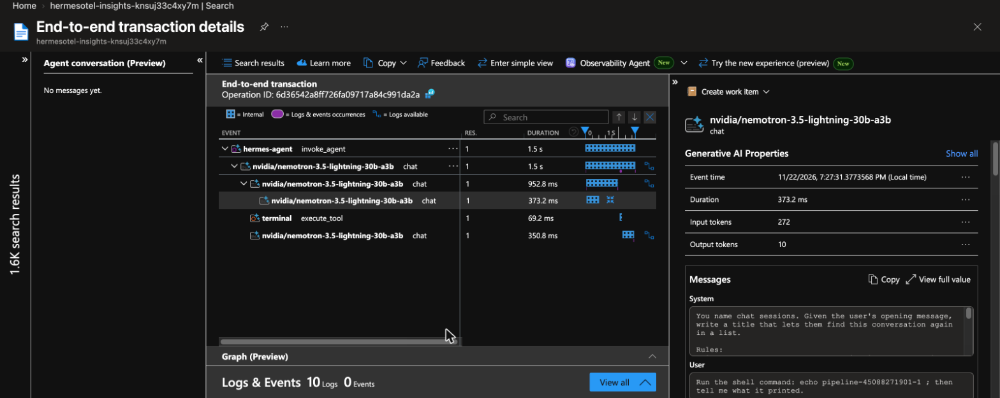
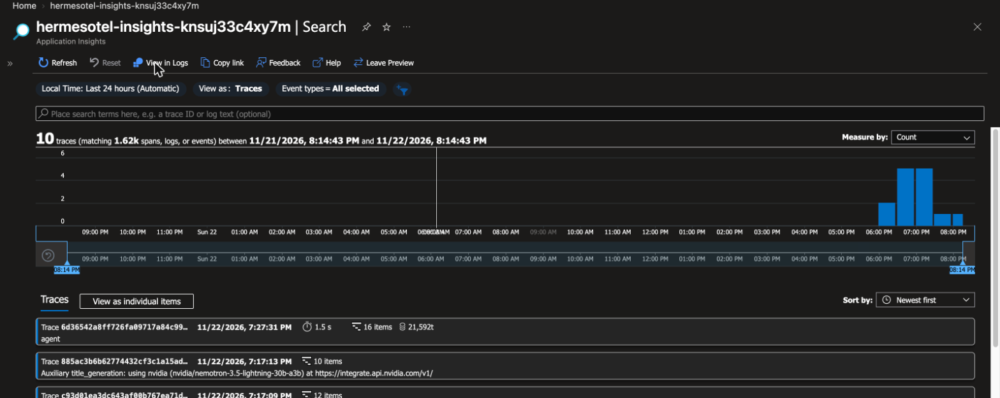
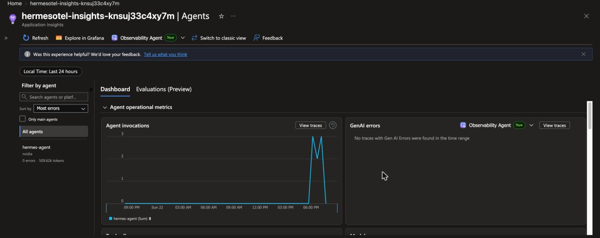
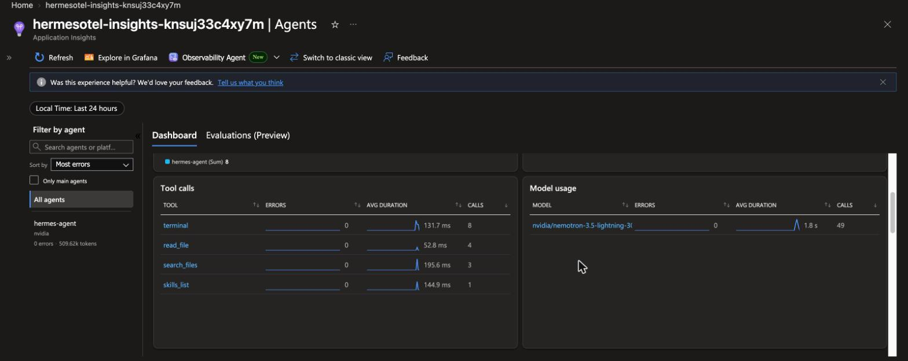
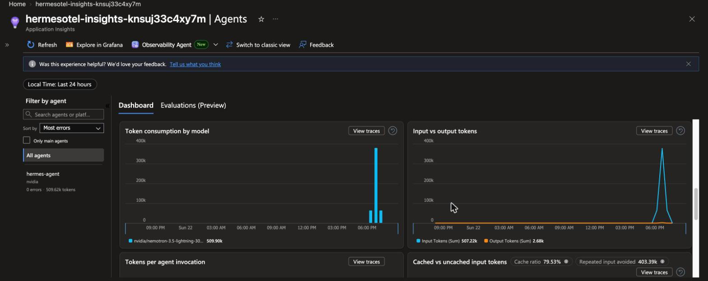
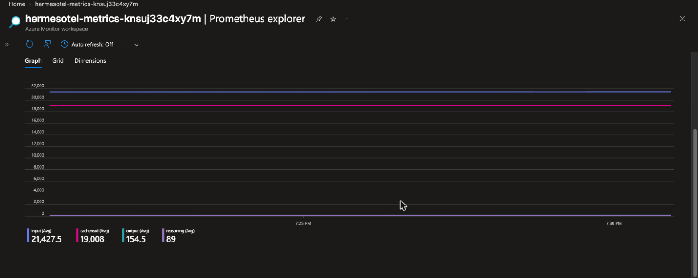
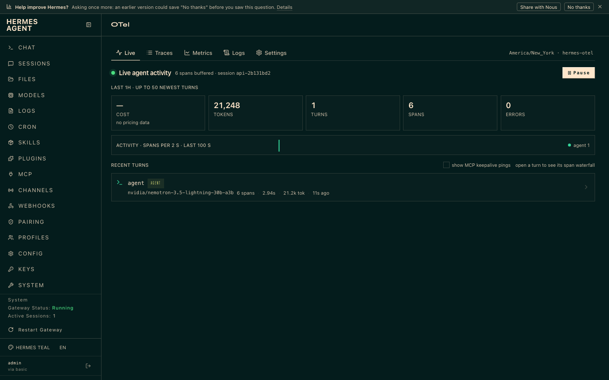

# Hermes Agent on Azure, observed with hermes-otel

A working demo: open-source [Hermes Agent](https://hermes-agent.nousresearch.com/)
in a container on Azure Container Apps, with hermes-otel sending its traces and
logs to Application Insights and its metrics to an Azure Monitor workspace. You chat with Hermes, and the
turn shows up as a trace in two places: Application Insights, and the OTel tab
of the Hermes dashboard.

This is self-hosted Hermes Agent in your own subscription. It is not Hermes
Enterprise, the product Nous Research offers with Microsoft.

Verified on 2026-11-22 in Central US with Hermes Agent v0.23.3.



## How it fits together

```
you ── HTTPS ──▶ Container App
                 ├─ proxy          /v1/*, /health ─▶ Hermes API server
                 │                 everything else ─▶ Hermes dashboard
                 ├─ hermes         Hermes Agent + hermes-otel
                 │                   │ traces, logs               │ metrics
                 │                   │ OTLP over gRPC             │ OTLP over HTTP
                 │                   ▼                            ▼
                 │        managed OpenTelemetry agent    ┌─ collector
                 │                   │                   │   signs in with the
                 │                   ▼                   │   app's managed identity
                 │        Application Insights           ▼
                 └────────────────────────────  data collection rule
                                                         │
                                                         ▼
                                              Azure Monitor workspace
```

| Resource | Purpose |
|---|---|
| Container registry | Holds the image built from `image/` and copies of the proxy and Collector images |
| Managed identity | Lets the container app pull from the registry and write metrics, without passwords |
| Log Analytics workspace | Storage behind Application Insights and the container logs |
| Application Insights | Where traces and logs land |
| Container Apps environment | Runs the managed OpenTelemetry agent |
| Azure Monitor workspace | Where metrics land (Prometheus-compatible) |
| Data collection endpoint and rule | Azure Monitor's OTLP intake for the metrics |
| Container app `hermesotel-agent` | Hermes Agent with hermes-otel, plus the proxy and an OpenTelemetry Collector |

The plugin needs no Azure-specific backend: its config
(`image/hermes_otel.yaml`) is two generic OTLP entries. Traces and logs go to
the endpoint the environment sets in `OTEL_EXPORTER_OTLP_ENDPOINT`. The managed
agent does not forward metrics to Application Insights, so metrics go to a
Collector in the same replica, which posts them to Azure Monitor's OTLP intake
with the app's managed identity:

```yaml
metrics_histogram: exponential      # what Azure Monitor's metric views expect

backends:
  - type: otlp
    name: azure-monitor
    endpoint: ${OTEL_EXPORTER_OTLP_ENDPOINT}
    protocol: grpc                  # the managed agent accepts gRPC only
    metrics: false

  - type: otlp
    name: azure-monitor-metrics
    endpoint: http://localhost:4318/v1/traces   # the Collector; /v1/metrics is derived
    traces: false
    logs: false
    metrics: true
    metrics_temporality: delta      # also what Azure Monitor expects
```

## Deploy it yourself

You need an Azure subscription, the [Azure CLI](https://learn.microsoft.com/cli/azure/install-azure-cli),
`jq`, and a model provider key (the demo uses an NVIDIA key).

```bash
az login
az group create --name hermes-otel-demo --location centralus

# 1. The registry to build into
az deployment group create -g hermes-otel-demo -n demo -f bicep/main.bicep
registry=$(az acr list -g hermes-otel-demo --query "[0].name" -o tsv)

# 2. The image: Hermes Agent plus hermes-otel, and copies of the proxy and Collector
az acr build --registry "$registry" --image hermes-otel-demo:dev image
az acr import --name "$registry" --source docker.io/library/caddy:2 --image caddy:2
az acr import --name "$registry" --source docker.io/otel/opentelemetry-collector-contrib:0.162.0 \
  --image opentelemetry-collector-contrib:0.162.0

# 3. Everything else
export NVIDIA_API_KEY=...                                   # your model key
export HERMES_API_SERVER_KEY=$(openssl rand -hex 32)        # protects the API
export HERMES_DASHBOARD_PASSWORD=$(openssl rand -hex 16)    # dashboard login, user "admin"
export HERMES_DASHBOARD_SESSION_SECRET=$(openssl rand -hex 32)
./parameters.sh hermes-otel-demo:dev > parameters.json
az deployment group what-if -g hermes-otel-demo -f bicep/main.bicep -p @parameters.json   # preview
az deployment group create  -g hermes-otel-demo -n demo -f bicep/main.bicep -p @parameters.json
rm parameters.json                                          # it holds the secrets

export HERMES_URL=$(az deployment group show -g hermes-otel-demo -n demo \
  --query properties.outputs.url.value -o tsv)
```

Keep the three generated values: you need the API key to chat and the
password to sign in.

## Chat with Hermes

**From a script.** Hermes serves an OpenAI-compatible API under `/v1`:

```bash
curl "$HERMES_URL/v1/chat/completions" \
  -H "Authorization: Bearer $HERMES_API_SERVER_KEY" \
  -H "Content-Type: application/json" \
  -d '{"model": "hermes-agent", "messages": [{"role": "user", "content": "What is the date? Use the terminal."}]}'
```

`./chat.sh` does the same with a marker in the prompt, so the trace can be
found afterwards.

**From a browser.** Open `$HERMES_URL`, sign in as `admin` with the dashboard
password, and use the **Chat** page.

## See the trace

**In Application Insights.** Telemetry is queryable a minute or two after the
turn. `./find-trace.sh <marker>` prints the spans of the chat `chat.sh` sent:

```
| span | ms | tokens | trace id |
| agent | 1244 | 21330 | f4e37ff061b995f80052237dbef20897 |
| llm.nvidia/nemotron-3.5-lightning-30b-a3b | 1235 |  | f4e37ff0… |
| api.nvidia/nemotron-3.5-lightning-30b-a3b | 402 | 281 | f4e37ff0… |
| tool.terminal | 67 |  | f4e37ff0… |
```

In the portal, open the Application Insights resource and use **Logs**. Spans
are in `dependencies`, log records in `traces`, and the role name is
`<environment name>.hermes-agent`:

```kusto
dependencies
| where timestamp > ago(1h)
| project timestamp, name, duration, operation_Id,
          model = customDimensions['gen_ai.request.model'],
          tokens = customDimensions['gen_ai.usage.total_tokens']
| order by timestamp desc
```

Every span attribute hermes-otel sets (`gen_ai.*`, `hermes.*`, `llm.*`,
`input.value`, `output.value`) arrives in `customDimensions`.

**Transaction search** lists the turns with their token totals; opening one
shows the end-to-end view in the screenshot at the top of this page.



**The Agents view** (under Investigate) lists `hermes-agent` with its
invocations, tool calls, model usage and token consumption. It works from the
OpenTelemetry GenAI attributes the plugin already sets.







**Metrics in Azure Monitor.** Metrics are exported about once a minute to the
Azure Monitor workspace, a Prometheus-compatible store. `./find-metrics.sh`
lists the metric names and totals the tokens of the last hour:

```
| token type | tokens, last hour |
| cacheread | 29568 |
| input | 42843 |
| output | 312 |
| reasoning | 187 |
```

In the portal, open the Azure Monitor workspace and use **Metrics** (or
**Prometheus explorer**) with PromQL. Metric names keep their dots, so select
them by name:

```promql
sum by (token_type) (sum_over_time({__name__="hermes.token.usage"}[1h]))
```

Reading metrics needs the **Monitoring Data Reader** role on the workspace;
`find-metrics.sh` grants it to whoever is signed in.



**In the Hermes dashboard.** Sign in at `$HERMES_URL` and open **OTel**. The
Live tab shows each turn as it happens, from the plugin's local store, with no
Azure query involved.



## The pipeline

`.github/workflows/azure-demo.yml` does all of the above from GitHub Actions.
Run it from the Actions tab (**Azure demo** → **Run workflow**), choosing
`deploy` or `remove`.

| Stage | What it does | Time in a full run |
|---|---|---|
| Create registry | Deploys `main.bicep` without an image | 55 s |
| Build image | Builds `image/` in the registry at the commit being run | 2 min 39 s |
| Preview changes | `what-if`: lists what the deployment would change | 32 s |
| Deploy Hermes | Deploys `main.bicep` with the new image | 1 min 27 s |
| Send test chat | `chat.sh`: asks Hermes to run a command | 10 s |
| Find trace in Azure Monitor | `find-trace.sh`: the chat's spans, in the run summary | 24 s |
| Find metrics in Azure Monitor | `find-metrics.sh`: metric names and token totals, in the run summary | 27 s |

It signs in to Azure with GitHub's OIDC token, so no Azure password is stored.
To use it in a fork, create an app registration with a federated credential
for `repo:<owner>/<repo>:environment:azure-demo`, give it Contributor and
Role Based Access Control Administrator on the resource group, and set these
on a GitHub environment named `azure-demo`:

- variables `AZURE_CLIENT_ID`, `AZURE_TENANT_ID`, `AZURE_SUBSCRIPTION_ID`, `AZURE_RESOURCE_GROUP`
- secrets `NVIDIA_API_KEY`, `HERMES_API_SERVER_KEY`, `HERMES_DASHBOARD_PASSWORD`, `HERMES_DASHBOARD_SESSION_SECRET`

## Remove it

```bash
az deployment group create -g hermes-otel-demo -n remove --mode Complete -f bicep/empty.bicep
```

That deletes every resource in the group and keeps the group. The resources
are billed while they exist; a few hours of this demo fits inside the monthly
free grants for Container Apps and Log Analytics, and the registry has a small
daily fee. Remove the demo when you are done.

## What to know

- **Hermes's data is ephemeral.** The container's data folder (config,
  sessions, the plugin's local store) lasts as long as the replica: a new
  deployment starts empty. An Azure Files SMB share does not work as that
  folder (Hermes keeps a local socket and builds Python environments there);
  durable storage on Azure Files NFS is tracked in the Azure demo milestone.
  Traces and logs in Application Insights are unaffected.
- **Metrics live in a different place from traces.** Traces and logs are in
  Application Insights; metrics are in the Azure Monitor workspace, queried
  with PromQL. The data collection rule links the two, so Application Insights
  knows which workspace holds this app's metrics.
- **Pick the region with care.** A Container Apps environment in East US 2
  stayed in `Waiting` for 50 minutes, twice; Central US took two minutes. A
  new subscription allows one environment in total.
- **The image carries what the Hermes image lacks.** `image/Dockerfile` adds
  the OTLP/gRPC exporter and PyYAML to the Hermes image, so Hermes does not
  build a new Python environment for the plugin at first boot.
- **The app is on the public internet.** The API needs the bearer key and the
  dashboard needs the password; both can run commands in the container.
  Treat the two values as you would an SSH key.
